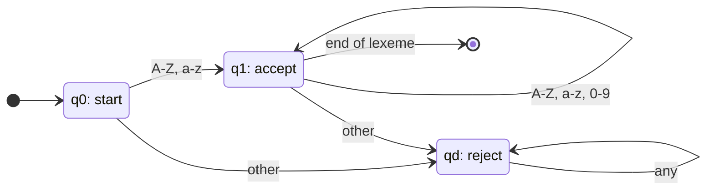
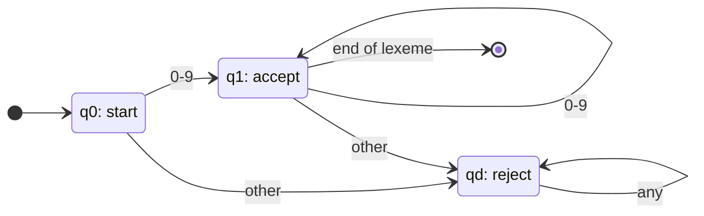

# Mini Lexical Analyzer ด้วย Python และ SLY

## ผู้จัดทำและวัตถุประสงค์ — ปาม

สมาชิกตาม `TEAM_ASSIGNMENTS.md`: ปาม, แฟนต้า, โรมัน, หยก, พอต และเตย
ก่อนส่งรายงาน ให้สมาชิกเติมชื่อ–นามสกุลและรหัสนักศึกษาจริง

โครงงานนี้ฝึกออกแบบ Regular Expression เพื่อจำแนก Source Code เป็น token
สร้าง Symbol Table สำหรับ Identifier และหยุดการวิเคราะห์ทันทีเมื่อพบ Lexical Error
โปรแกรมทำเฉพาะ lexical analysis ไม่ตรวจไวยากรณ์หรือคำนวณผลของ Source Code

## แนวคิด Lexer และ Regular Language — แฟนต้า

Lexer อ่านข้อความจากซ้ายไปขวาและส่ง token ที่มีชนิด ค่า ตำแหน่งเริ่ม และเลขบรรทัด
SLY รวมกฎ Regex เป็นตัวจับคู่ และเลือกกฎตามลำดับที่ประกาศใน class
ดังนั้นกฎ Comment ต้องอยู่ก่อน `/` และ Operator สองอักขระต้องอยู่ก่อนตัวสั้น
โปรแกรมใช้ `MiniLexer(Lexer)` และกฎ Regex ของ SLY สำหรับการจำแนก token
การตรวจชื่อซ้ำ การ remap Keyword และการยก exception เป็น action หลังจับคู่กฎ

รูปแบบ Identifier และ Integer เป็น Regular Language จึงแทนได้ด้วย DFA
Regex นิยามรูปแบบที่ยอมรับ ส่วน DFA แสดงสถานะและการเปลี่ยนสถานะเมื่ออ่านอักขระ

## รายละเอียด Token และ Regular Expression

Regex ในตารางเป็นรูปแบบทางตรรกะ ส่วน Python ใช้ raw string ใน `src/lexer.py`
คำว่า rejected หมายถึงไม่เป็น token ประเภทนั้นทั้ง lexeme
บางกรณียังแยกเป็น token ที่ถูกต้องหลายตัวได้ เช่น `-10` เป็น `MINUS` และ `INTEGER`

### Operators, Parentheses และ Semicolon — ปาม

| Lexeme | Token | Regex |
|---|---|---|
| `>=` | `GE` | `>=` |
| `<=` | `LE` | `<=` |
| `==` | `EQ` | `==` |
| `++` | `INCREMENT` | `\+\+` |
| `--` | `DECREMENT` | `--` |
| `+` | `PLUS` | `\+` |
| `-` | `MINUS` | `-` |
| `*` | `TIMES` | `\*` |
| `/` | `DIVIDE` | `/` |
| `=` | `ASSIGN` | `=` |
| `>` | `GT` | `>` |
| `<` | `LT` | `<` |
| `(` | `LPAREN` | `\(` |
| `)` | `RPAREN` | `\)` |
| `;` | `SEMICOLON` | `;` |

Accepted: `+`, `>=`, `++`, `(`, `)`, `;`
Rejected ในฐานะ Operator เดี่ยว: `@`, `!`, `!=`
`+++` แยกเป็น `INCREMENT` และ `PLUS`; `!=` พบ error ที่ `!` ทันที

### Keywords และ Identifier — แฟนต้า

Identifier ใช้ Regex `[a-zA-Z][a-zA-Z0-9]*` โดยไม่อนุญาต `_` หรืออักษรนอกภาษาอังกฤษ
หลัง match ชื่อเต็มแล้วใช้ SLY remapping แยก Keywords 10 คำ:

| Keyword | Token |
|---|---|
| `if` | `IF` |
| `then` | `THEN` |
| `else` | `ELSE` |
| `endif` | `ENDIF` |
| `while` | `WHILE` |
| `do` | `DO` |
| `endwhile` | `ENDWHILE` |
| `print` | `PRINT` |
| `newline` | `NEWLINE` |
| `read` | `READ` |

Accepted Identifier: `A`, `score`, `id1`, `student123`, `If`, `IF`, `Print`, `READ`, `if1`
Rejected Identifier: `1score`, `_score`, `student_name`, `@id`
`if` เป็น Keyword จึงไม่เข้า Symbol Table ส่วน `if1` เป็น Identifier ทั้งชื่อ
`student_name` ให้ token `student` ก่อนพบ error ที่ `_` และไม่วิเคราะห์ `name` ต่อ

ข้อตกลงเพิ่มเติมของกลุ่ม: ใช้กฎ `[0-9]+[a-zA-Z][a-zA-Z0-9]*` ก่อน Integer
เพื่อปฏิเสธชื่ออย่าง `1score` ที่อักขระแรก โดยไม่แยกเป็น Integer กับ Identifier
โจทย์ระบุว่า `1score` เป็น Identifier ที่ไม่ถูกต้อง แต่ไม่ได้ระบุผลการแยก token ของกรณีนี้

### Integer และ String — โรมัน

Integer ใช้ `[0-9]+` รับเฉพาะเลข ASCII ไม่ติดลบ
Accepted: `0`, `123`, `12345`, `001`; เก็บข้อความเดิมจึงยังแสดง `001`
Rejected ในฐานะ Integer เดี่ยว: `-10`, `1.5`, `abc`
`-10` แยกเป็น `operator: -` และ `integer: 10`
`1.5` แสดง `integer: 1` แล้ว error ที่ `.` และหยุด

String ใช้ `"[^"\r\n]*"` เพิ่มการห้าม `\r` เพื่อรองรับไฟล์หลายระบบ
Accepted: `""`, `"Hello World"`, `"Score is 100"`, `"// @ /* */"`
ข้อความลักษณะ Comment และสัญลักษณ์อื่นภายใน String เป็นเนื้อหา ไม่ถูกแยกอีก
Rejected: String ที่ไม่มี quote ปิดหรือมีอักขระขึ้นบรรทัดใหม่ก่อน quote ปิด
เก็บ quote ไว้ในค่า token และไม่แปล escape sequence เช่น `\n`
Backslash เป็นอักขระธรรมดา จึงไม่ทำให้ quote ถัดไปกลายเป็น escaped quote
กฎ quote เปิดที่เหลือจาก String สมบูรณ์จะยก `LexicalError` ทันที

### Comments, Whitespace และ Lexical Error — หยก

| ส่วน | Regex / วิธี | พฤติกรรม |
|---|---|---|
| Single-line Comment | `//[^\r\n]*` | ข้ามจนถึงก่อนขึ้นบรรทัดใหม่หรือ EOF |
| Block Comment | `/\*[\s\S]*?\*/` | ข้ามได้หลายบรรทัด จบที่ `*/` แรก |
| Block Comment ไม่ปิด | `/\*` หลังจากกฎสมบูรณ์ | ยก error ที่ `/` เปิด |
| Whitespace | `ignore = " \t\f\v"` | ข้ามระหว่าง token |
| ขึ้นบรรทัดใหม่ | `\r\n` หรือ `[\r\n]` | เพิ่มเลขบรรทัด โดย CRLF นับครั้งเดียว |
| อักขระที่ไม่ match | SLY เรียก `error()` | ยก `LexicalError` พร้อมอักขระแรกที่ผิด |

Accepted Comments: `// comment`, `/**/`, `/* first` ตามด้วยบรรทัดใหม่และ `second */`
Rejected Block Comment: `/* never closed`, `/*/`
ไม่รองรับ nested block comments และไม่เพิ่มชื่อใดจาก Comment เข้า Symbol Table
`newline` เป็น Keyword ขณะที่อักขระขึ้นบรรทัดใหม่เป็น whitespace

`LexicalError` เก็บ `character`, `lineno` (เริ่ม 1), `index` (เริ่ม 0) และ `reason`
การยก exception หยุด generator ทันที ไม่ข้ามอักขระผิดแล้วทำงานต่อ
สำหรับ String และ Block Comment ไม่ปิด ให้แจ้งอักขระเปิดตามข้อตกลงกลุ่ม
ข้อความบนหน้าจอใช้รูปแบบเดียวกับโจทย์ ส่วนเหตุผลเฉพาะเก็บใน `reason`

## Symbol Table และ Output — พอต

ใช้ `dict[str, None]` เพื่อให้ตรวจชื่อซ้ำโดยเฉลี่ย O(1) และเก็บลำดับที่พบครั้งแรก
`add(name)` คืน `True` เมื่อเป็นชื่อใหม่ และ `False` เมื่อซ้ำ
`A` กับ `a` เป็นคนละชื่อ และ property `identifiers` คืน tuple เพื่ออ่านข้อมูล
Formatter เพิ่มเฉพาะ token `IDENTIFIER`; Keyword และ token ชนิดอื่นไม่เข้า Table
เตยสร้าง Table ใหม่ใน `analyze()` แต่ละครั้ง

รูปแบบผลลัพธ์:

```text
new identifier: A
identifier "A" already in symbol table
operator: +
keyword: if
integer: 123
string: "Hello World"
left parenthesis: (
right parenthesis: )
semicolon: ;
Lexical error: unexpected character @
```

ใช้ `new identifier: A` สำหรับชื่อใหม่ตามหัวข้อ Output Format ของ PDF
แม้ตัวอย่าง error หน้า 6 จะย่อเป็น `identifier: A` ซึ่งไม่ตรงกับหัวข้อรูปแบบผลลัพธ์หลัก

## Finite Automata

### DFA ของ Identifier — แฟนต้า

ต้นฉบับ: [identifier.mmd](automata/identifier.mmd)



`q0` เป็นสถานะเริ่ม ไม่ยอมรับข้อความว่าง อ่านตัวอักษรอังกฤษตัวแรกแล้วไป `q1`
`q1` เป็นสถานะยอมรับและวนซ้ำเมื่ออ่านตัวอักษรอังกฤษหรือตัวเลข
อักขระอื่นพาไป `qd` ซึ่งเป็น dead state เมื่อสิ้น lexeme ต้องอยู่ `q1` จึงยอมรับ
DFA นี้ตรวจรูปคำก่อนแยก Keyword ด้วยการเทียบคำเต็ม

### DFA ของ Integer — โรมัน

ต้นฉบับ: [integer.mmd](automata/integer.mmd)



ต้องอ่านเลขอย่างน้อยหนึ่งหลักเพื่อไป `q1` และวนที่ `q1` เมื่ออ่านเลขเพิ่ม
ตัวอักษรอื่นพาไป `qd` จึงไม่รับเครื่องหมายลบหรือจุดทศนิยมเป็นส่วนหนึ่งของ Integer
ทั้งสองภาพเป็น DFA ตรวจ lexeme หนึ่งคำ ไม่ใช่การสั่งให้ Lexer อ่านทั้งไฟล์เป็น token เดียว
ลูกศรไปจุดจบใช้แสดงการสิ้นสุด lexeme ไม่ใช่ epsilon transition ของ DFA

## วิธีใช้งานและตัวอย่าง — เตย

ติดตั้งตาม [README](../README.md) แล้วรันจากรากโปรเจกต์:

```bash
python main.py inputs/sample1.txt
```

Input ตาม PDF หน้า 8:

```text
A + B - * if then id1 id2 id1 "Hello World"
```

Output ที่ตรวจจากโปรแกรม:

```text
new identifier: A
operator: +
new identifier: B
operator: -
operator: *
keyword: if
keyword: then
new identifier: id1
new identifier: id2
identifier "id1" already in symbol table
string: "Hello World"
```

`sample2.txt` เป็นตัวอย่างเพิ่มเติมหน้า 8–9 มี Keyword, Identifier ซ้ำ และ Comment ทั้งสองแบบ
ผลลัพธ์ครบถูกบันทึกเป็น expected output ใน `test/test_lexer.py`
`all_tokens.txt` เป็นตัวอย่างเพิ่มเติมที่มี token ครบทุกชนิด
ไฟล์ทดสอบไม่มี comment ระบุเจ้าของใน `sample1.txt` และ `sample2.txt` เพื่อรักษา Input ตาม PDF
ผู้ดูแลไฟล์ตัวอย่างทั้งหมดคือเตย

รันกรณี error:

```bash
python main.py inputs/lexical_error.txt
```

```text
new identifier: A
Lexical error: unexpected character @
```

ไม่มีผลของ `B` หรือบรรทัด `print` ที่อยู่หลัง error และ exit code เป็น `1`
โปรแกรมแสดงผลทันทีที่ได้ token ไม่ใช้ `list()` วิเคราะห์ทั้งไฟล์ก่อนแสดงผล
File error แสดงทาง stderr และคืน `2`; การทำงานสำเร็จคืน `0`

## การทดสอบและผลจริง — ทุกคนตามส่วนของตน, เตยรวม

รัน `python -m pytest -q` เมื่อ 23 ตุลาคม 2569 บน Python 3.12 และ SLY 0.5
ผลจริง: **119 passed in 1.32s**

| เจ้าของ | Prefix ของ tests | สิ่งที่ตรวจ |
|---|---|---|
| ปาม | `test_operators_`, `test_delimiters_` | Operator ทั้ง 12 ตัว ลำดับกฎ และวงเล็บ/semicolon |
| แฟนต้า | `test_keywords_`, `test_identifier_` | Keyword ทั้ง 10 คำ case prefix และชื่อผิดกฎ |
| โรมัน | `test_integer_`, `test_string_` | จำนวนเต็ม เลขศูนย์นำหน้า String ว่าง ขอบเขต String |
| หยก | `test_comment_`, `test_whitespace_`, `test_lexical_error_` | Comment, CRLF/LF/CR, ตำแหน่ง error และการหยุด |
| พอต | `test_symbol_table_`, `test_output_` | ชื่อซ้ำ case ลำดับ ชนิดที่เก็บ และข้อความผลลัพธ์ |
| เตย | `test_integration_` | CLI เทียบ PDF, exit code, BOM, path มีช่องว่าง และ file error |

Integration tests เรียก `main.py` เป็น subprocess จริงและเทียบ stdout แบบตรงทุกบรรทัด
Expected output ของ PDF เขียนแยกจากการทำงานของ Lexer เพื่อจับข้อผิดพลาดของโปรแกรม
Test ตรวจด้วยว่าชนิด token ที่พบใน `all_tokens.txt` ครบชุดที่ประกาศใน Lexer
การรันตัวอย่างทั้งสองไฟล์และไฟล์ error โดยตรงให้ผลตรงกับชุดทดสอบ

ภาพหน้าจอจริงยังต้อง Capture จากเครื่องที่ใช้สาธิตและเพิ่มใน `docs/screenshots/` ก่อนส่งรายงาน
ผลใน code block ด้านบนเป็นข้อความจากการรันจริง ไม่ใช่ภาพหน้าจอ

## สรุปผล — เตย

โปรแกรมอ่านไฟล์ `.txt` ด้วย Python และแยก token ด้วย SLY ได้ตามขอบเขตที่กำหนด
Symbol Table ตรวจ Identifier ซ้ำและแยกตัวพิมพ์เล็ก/ใหญ่ได้
Comment และ Whitespace ถูกข้าม และ Lexical Error หยุดการวิเคราะห์ทันที
ขอบเขตที่ไม่รองรับคือเลขทศนิยม การตีความ escape sequence String หลายบรรทัด
และ nested block comment การตรวจไวยากรณ์อยู่นอกขอบเขตโครงงานนี้

## เอกสารอ้างอิง

- เอกสารโจทย์ `TermReport1-2569 (1).pdf` วิชา 05506237 โดยเฉพาะหน้า 1–9
- [SLY documentation — กฎ Regex, Token Remapping และ Error Handling](https://sly.readthedocs.io/en/latest/sly.html)
- [TEAM_ASSIGNMENTS.md](../TEAM_ASSIGNMENTS.md) สำหรับเจ้าของแต่ละส่วน
